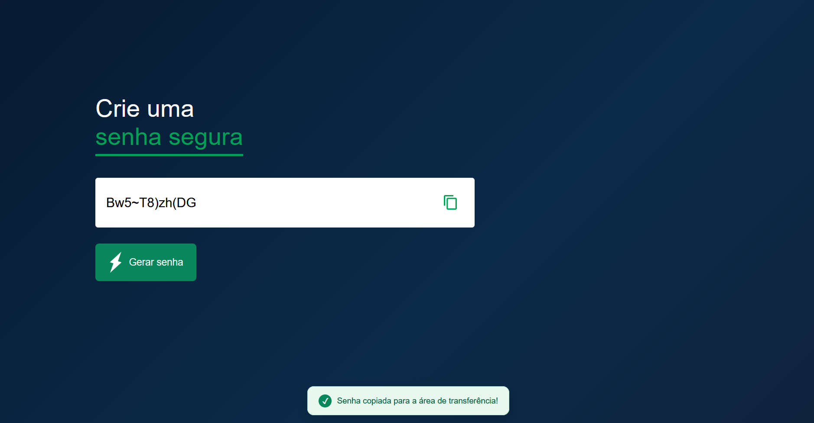

# 🔐 Gerador de Senhas

Uma página simples para gerar senhas aleatórias e copiá-las para a área de transferência. O projeto foi feito com HTML, CSS e JavaScript, sem dependências externas.

## Visual



## Funcionalidades

- Gera senhas com 12 caracteres.
- Inclui pelo menos uma letra maiúscula, uma letra minúscula, um número e um símbolo.
- Permite copiar a senha com o botão ao lado do campo.
- Exibe um aviso quando a senha é copiada.

## Como usar

1. Abra o arquivo `index.html` em um navegador.
2. Clique em **Gerar senha**.
3. Para copiar, clique no ícone ao lado da senha.

## 📁 Estrutura do projeto

```text
projeto07-randompassword/
├── img/
│   ├── copy.png
│   └── generate.png
├── index.html
├── README.md
└── style.css
```

## 🛠️ Tecnologias

- HTML
- CSS
- JavaScript

> **Observação:** este projeto usa `Math.random()` para gerar as senhas e foi criado para fins de aprendizado. Para contas ou dados importantes, prefira um gerador que use aleatoriedade criptograficamente segura.

---

<p align="center">
  Desenvolvido por <a href="https://github.com/LucMNS"><b>LucMNS</b></a>
</p>